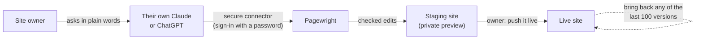

# Pagewright

**Edit your website by asking your own AI. Safely.**

Pagewright lets the owner of a website change it just by asking Claude or
ChatGPT: *"Change the tagline to …"*, *"Add the Hillside project to the
portfolio"*, *"Make the headings Playfair Display"*, *"Push it live."* Every
change lands on a staging copy of the site first. The owner looks at it, says
the word, and it goes live. If they change their mind, any earlier live version
is one sentence away.

Pagewright is the editing system behind the custom websites we build for our
clients. This repository describes it; the code itself is private.

<!-- TODO(screenshot): hero image. A Claude chat on one side ("Change the
homepage headline to …"), the staging site with the change on the other. -->

---

## The problem

Small-business websites get stuck between two bad options:

- **A CMS or site builder.** The owner has to learn another dashboard, and the
  design can drift every time someone drags a block around.
- **"Just email the developer."** Every typo fix, new photo or job posting
  waits in someone's inbox.

Most business owners already use an AI assistant every day. Pagewright lets
that assistant make their website changes too, without handing it the keys to
the site's code. It works through a small set of editing tools that can only
make changes the site is built to accept.

## Who it's for

Business owners (builders, contractors, studios, local services) who want to
change their own site's words, photos, colors and fonts without learning new
software. If you can type or speak a request to Claude or ChatGPT, you can
edit your site. Talking is often quicker: the Claude and ChatGPT apps take
voice input, and [Loquio](https://webdevs.net/portfolio/loquio), our free,
on-device voice dictation app (coming soon), lets you speak a request into any
app.

## How it works

1. **Connect once.** You add your site as a connector in Claude or ChatGPT,
   using the address we send you, and sign in with your editor password. That's
   the whole setup.
2. **Ask for a change.** "Update Sarah's title to Project Manager." Your AI
   uses Pagewright's editing tools, which check the change before saving it.
3. **Look at it on staging.** Every edit goes to a staging copy of your site,
   marked with a banner and hidden from search engines. Your AI gives you a
   link to the exact page that changed, and can list everything that isn't
   live yet.
4. **Push it live.** When you're happy, say "push it live", and you get a
   plain-English recap of what just went out. Changed your mind? The staging
   changes can be thrown away instead.
5. **Undo anytime.** Every push saves the previous live site, so you can bring
   back any earlier version.

Changes show up right away: no rebuild, no waiting for a developer to deploy.

<!-- TODO(screenshot): the staging banner on a page, next to the preview link
the AI returned. -->

## What you can change

| Area | What you can do | Why it matters |
|---|---|---|
| **Words and lists** | Edit any text; add, remove and reorder things like projects, team members, services and job openings | Everyday edits happen the same day |
| **Photos** | Add images from a link (for example Dropbox or Google Drive); they're optimized for the web automatically | Fast-loading pages without thinking about file formats |
| **Colors** | Pick a ready-made palette or set individual colors | Contrast is checked, so text stays readable |
| **Fonts** | Use any Google Fonts family by name, for headings and body text; typos get "did you mean" suggestions | 1,900+ fonts, served from your own site so visitors' browsers never contact Google |
| **Layout** | Reorder home page sections, adjust spacing, content width and corner rounding, and switch between the layout options your site offers | Real design changes, inside the limits your designer set |
| **Logo, tagline and footer** | Upload a new logo (a different one for the footer if you like), resize it, edit the tagline and the footer's text and links | Rebrands and new phone numbers don't need a developer |
| **Search results** | Page titles and search descriptions | Tune how you appear in Google |
| **Email settings** | Who receives contact-form messages (and job applications, on sites with job pages) | No more forms going to someone who left |

The exact options depend on how your site was designed.

## Built so the AI can't break your site

Letting an AI edit a live business website only works if mistakes can't get
through. Pagewright is built around that:

- **Staging first, always.** Nothing reaches visitors until you push it live.
- **Every edit is checked before it's saved.** A change that would remove
  something the page needs, point at a missing photo or break a link is
  refused, and your AI is told why in plain words.
- **Design guardrails.** Colors are checked for readable contrast, fonts
  against the Google Fonts catalog, and layout options against what your site
  supports.
- **No access to code.** Your AI only sees your content and settings. It never
  touches the site's code, the server or hosting.
- **One-step rollback.** The last 100 live versions are kept, and any of them
  can be restored.
- **Secure sign-in.** Connecting uses the standard OAuth sign-in that Claude
  and ChatGPT support, with a password for your site.
- **A record of every change.** Each edit, push and rollback is recorded with
  when it happened, what changed and why, so we can always answer "what
  happened to that page?"

<!-- TODO(screenshot): the change history page, with one "Went live" card and
its What / Before / After table. Use a demo site, not a client's. -->

## Getting started

Pagewright comes with the websites we build. It isn't sold separately.

<!-- TODO: how people should get in touch (website, email or contact form). -->

<!-- TODO: client quotes or results, only if the clients agree to be named. -->
